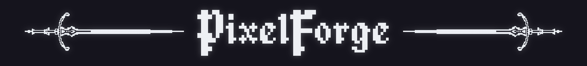

<p align="center">
  
</p>

# PixelForge

PixelForge is a command-line image-processing tool written in Python. It applies retro and glitch-style effects (colour quantisation, fixed retro palettes, ordered dithering, pixel sorting and ASCII art) through a modular, chainable effects pipeline.

Every effect is implemented from scratch on top of [Pillow](https://python-pillow.org/).

PixelForge is built as a **pipeline of effects**:

```
input image ──▶ effect ──▶ effect ──▶ … ──▶ output image
```

Every effect is a subclass of `Effect` (`pixelforge/pipeline.py`). `Pipeline` holds a list of effects and runs them in order, passing each one's output to the next.


## Contents

- [Features](#features)
- [Getting started](#getting-started)
- [Usage](#usage)
- [Project structure](#project-structure)
- [Effects in detail](#effects-in-detail)
  - [Colour quantisation (median cut)](#colour-quantisation-median-cut)
  - [Fixed palettes](#fixed-palettes)
  - [Ordered dithering (Bayer)](#ordered-dithering-bayer)
  - [Pixel sorting](#pixel-sorting)
  - [ASCII art](#ascii-art)
- [Roadmap](#roadmap)

---

## Features

| Effect | What it does | Flag |
|---|---|---|
| **Colour quantisation** | Reduces an image to *N* colours using a custom median cut algorithm | `--quantize` |
| **Fixed palettes** | Maps an image onto a classic palette such as Game Boy, PICO-8 or CGA | `--palette NAME` |
| **Ordered dithering** | Black and white ordered dithering with a 4×4 Bayer matrix | `--dither` |
| **Pixel sorting** | Sorts runs of pixels in each row by brightness, within a brightness threshold (defaulted to range between 40-235) | `--pixelsort` |
| **ASCII art** | Redraws an image as ASCII characters | `--ascii` |

Effects can be combined in any order, and the same effect can be used more than once.

---

## Getting started

### Requirements

- Python 3.11 or newer (developed on 3.14)
- [Pillow](https://pypi.org/project/pillow/) 12.1 or newer
- [NumPy](https://pypi.org/project/numpy/)

### Installation

The easiest way to install PixelForge as a command is with [pipx](https://pipx.pypa.io/), which installs it into its own isolated environment and makes `pixelforge` available in every terminal:

```bash
pipx install git+https://github.com/dsy17/PixelForge.git
```

### Development setup

For the project itself, clone the repository and install it into a virtual environment:

```bash
git clone https://github.com/dsy17/PixelForge.git
cd PixelForge

# Windows
py -m venv .venv
.venv\Scripts\activate

# macOS / Linux
python3 -m venv .venv
source .venv/bin/activate

# then

pip install -e .
```

This installs the dependencies and adds a `pixelforge` command to the virtual environment, which needs activating in each new terminal. The `-e` (editable) flag runs the code straight from the cloned folder, so changes take effect without reinstalling.

To install only the exact dependency versions PixelForge was tested with, without the command, use `pip install -r requirements.txt` and run it as `python -m pixelforge.cli`.

---

## Usage

```bash
pixelforge INPUT OUTPUT [effects...] [settings...]
```

**Effects run in the order you type them.** Each effect receives the previous effect's output:

```bash
# Generate an 8-colour palette from the image
pixelforge photo.png out.png --quantize --colors 8

# Map onto the Game Boy palette, then dither
pixelforge photo.png out.png --palette gameboy --dither

# Order matters: these two give different results
pixelforge photo.png out.png --pixelsort --palette pico-8
pixelforge photo.png out.png --palette pico-8 --pixelsort

# Pixel sort a narrower brightness range, bright to dark
pixelforge photo.png out.png --pixelsort --lower 80 --upper 200 --reverse

# ASCII art, 120 characters wide
pixelforge photo.png out.png --ascii --ascii-width 120
```

The output format is chosen from the output file's extension (`.png`, `.jpg`, `.bmp`, …). PixelForge won't replace an existing file unless you add `--overwrite`. Run `pixelforge --help` for the full list of options.

### Effects

| Flag | Description |
|---|---|
| `--quantize` | Reduce the number of colours using a palette generated from the image (median cut) |
| `--palette NAME` | Quantise to a fixed palette instead. Use it *instead of* `--quantize`, not as well |
| `--dither` | Ordered (Bayer 4x4) dithering to black and white |
| `--ascii` | Redraw the image as ASCII characters |
| `--pixelsort` | Sort runs of pixels in each row by brightness |

### Settings

| Flag | Used by | Default |
|---|---|---|
| `--colors N` | `--quantize` | 16 |
| `--ascii-width N` | `--ascii` | 100 characters |
| `--lower N` | `--pixelsort` | 40 |
| `--upper N` | `--pixelsort` | 235 |
| `--reverse` | `--pixelsort` | off (dark to bright) |
| `--overwrite` | output file | off (an existing output file is an error) |

Settings apply to every use of an effect, so in `--quantize --dither --quantize --colors 4` both quantise steps use 4 colours.


### Running an effect on its own

Each effect module has a small demo that runs it on `resources/image.png` and opens the result in your image viewer. For each effect, run:

```bash
python -m pixelforge.effects.quantize
python -m pixelforge.effects.dither
python -m pixelforge.effects.pixelsort
python -m pixelforge.effects.ascii
```

---

## Project structure

```
PixelForge/
├── pixelforge/
│   ├── cli.py              # Command-line interface (argparse)
│   ├── pipeline.py         # Effect base class and Pipeline
│   ├── image_io.py         # load_image() / save_image() with clear errors
│   ├── paths.py            # PALETTES and RESOURCES path constants
│   ├── effects/
│   │   ├── quantize.py     # Median cut quantisation and palette mapping
│   │   ├── dither.py       # Bayer ordered dithering
│   │   ├── pixelsort.py    # Brightness-threshold pixel sorting
│   │   └── ascii.py        # ASCII conversion and text-to-image rendering
│   └── palettes/           # Fixed palettes as .hex files (see palettes/README.md)
├── resources/              # Local test images (not tracked)
├── pyproject.toml          # Config file
├── requirements.txt        # Dependency versions
└── README.md
```

---

## Effects in detail

### Colour quantisation (median cut)

`pixelforge/effects/quantize.py`

Quantisation reduces an image to a small palette of colours in two steps: **choose the palette**, then **map every pixel to its nearest palette colour**.

**1. Choosing the palette with median cut**

Every pixel is treated as a point in 3D RGB space. The algorithm repeatedly cuts that cloud of points into boxes:

1. Start with one box containing every pixel.
2. Pick the box whose colours vary the most (`widest_range`).
3. Find that box's widest channel: red, green or blue.
4. Sort the box along that channel and split it at the **median**, so each half holds the same number of pixels.
5. Repeat until there are *N* boxes, or until no box can be split further.
6. Average each box into a single colour (`box_average`). These averages are the palette (`build_palette`).

Splitting at the median, rather than the midpoint of the range, means colours that cover large areas of the image get more palette entries. A large range of similar RGB values gets several shades, while small details gets fewer.

To keep it fast, the palette is built from a 128×128 thumbnail (resized with nearest-neighbour to avoid blended colours from entering the mix) and then applied to the full-size image.

**2. Mapping pixels to the palette**

For each pixel, `find_nearest` picks the palette colour with the smallest squared distance:

```
(r1 − r2)² + (g1 − g2)² + (b1 − b2)²
```

This is computed with NumPy across the whole palette at once. Results are cached in a dictionary, so each distinct colour is only looked up once.

### Fixed palettes

`pixelforge/palettes/*.hex`, loaded by `load_palette()` in `pixelforge/effects/quantize.py`

Instead of generating a palette, an image can be mapped onto a classic fixed palette with `--palette NAME`, thus skipping the need for median cut. Palettes are retreived from [Lospec](https://lospec.com/palette-list).

Palettes are stored as plain `.hex` files. This is the format Lospec exports, so new palettes can be downloaded from here and dropped into `pixelforge/palettes/`. The CLI finds them automatically and lists them in `--help`.

| Palette | Colours |
|---|---|
| `1bit` | 2 |
| `gameboy` | 4 |
| `cga` | 4 |
| `cga16` | 16 |
| `zx-spectrum` | 15 |
| `commodore64` | 16 |
| `pico-8` | 16 |
| `dawnbringer-16` | 16 |
| `sweetie-16` | 16 |

Palettes with a wide range of colours (PICO-8, Sweetie 16, DawnBringer 16) work best. Palettes made of shades of a single colour, like `gameboy`, can lose detail, because nearest-colour matching sends most light colours to the same shade. Matching by brightness instead is on the [roadmap](#roadmap).

### Ordered dithering (Bayer)

`pixelforge/effects/dither.py`

Dithering simulates more tones than are actually available by arranging pixels in patterns. PixelForge uses **ordered dithering** with a 4×4 Bayer matrix:

```
 0  8  2 10
12  4 14  6
 3 11  1  9
15  7 13  5
```

The matrix is scaled to 16 brightness thresholds across 0–255 and tiled across the image. Each pixel is compared with the threshold at its position (`x % 4`, `y % 4`): brighter pixels become white and darker ones black.

### Pixel sorting

`pixelforge/effects/pixelsort.py`

Pixel sorting is a glitch-art effect that rearranges pixels into smooth streaks.

1. For each row, `find_intervals` finds runs of consecutive pixels whose brightness falls between `--lower` and `--upper` (40–235 by default).
2. Each run is sorted by perceived brightness (luma: `0.299R + 0.587G + 0.114B`), dark to bright (or bright to dark with `--reverse`).
3. Pixels outside the threshold (shadows and highlights) stay where they are, which keeps the image recognisable.

### ASCII art

`pixelforge/effects/ascii.py`

1. The image is resized to `--ascii-width` characters across and converted to greyscale.
2. Each pixel's brightness is mapped to a character from a **density ramp**, a string ordered by character density. The index is scaled to the string's length, so any lengths work.
3. `ascii_to_image` renders the text back into an image. It measures one character cell with `font.getbbox` and draws each character on a square grid, so one character corresponds to one pixel of the resized image.

The font is chosen per operating system: Consolas on Windows, Menlo on macOS, DejaVu Sans Mono on Linux, falling back to Pillow's built-in font. Because each character is drawn in its own grid cell, the output lines up even with the fallback font.

Two ramps are included: `classic` (short and bold) and `detailed` (about 70 characters, for finer gradients).

---

## Roadmap

**CLI**
- [x] `Effect` base class and `Pipeline`
- [x] Command-line interface with effects run in typed order
- [x] `--palette` with automatic palette discovery
- [x] Clear error messages and exit codes
- [x] Installable package with a `pixelforge` command
- [ ] Help text for every setting
- [ ] ASCII options: character ramp, font size and colours

**Effects**
- [ ] Brightness-based matching for single-colour palettes such as `gameboy`
- [ ] Colour (RGB) dithering, and Floyd–Steinberg error diffusion
- [ ] Column-based pixel sorting
- [ ] Coloured ASCII output, using each pixel's original colour
- [ ] k-means refinement for quantisation
- [ ] Faster processing with NumPy vectorisation
